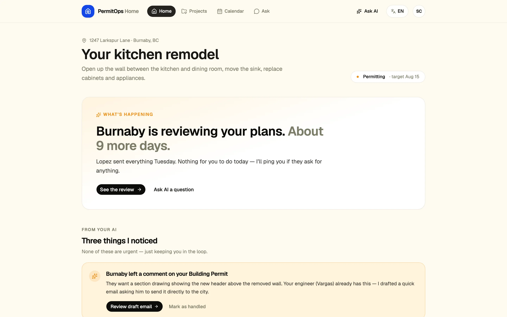
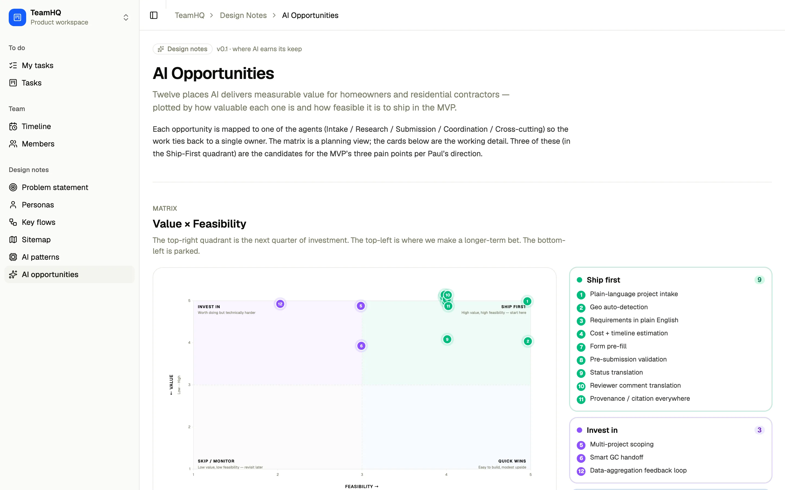
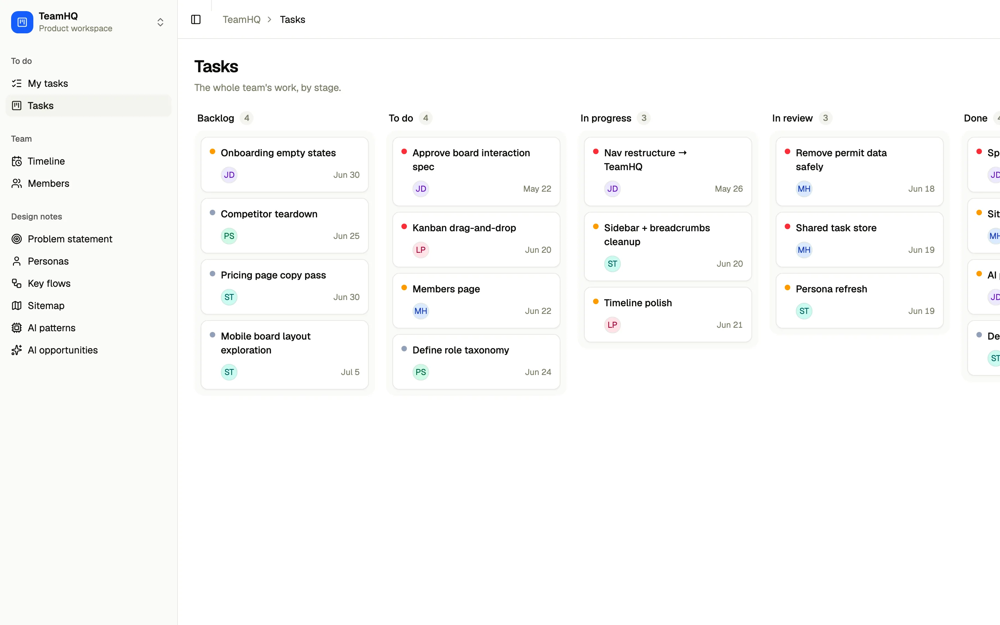

# PermitOps — interview demo

A construction-permit management product designed end-to-end as an interview deliverable. The brief: come back with a working prototype plus a clear point of view on the problem, the users, and how AI fits into the experience. **Permitflow** ([permitflow.com](https://permitflow.com)) is the competitive reference.



**Live:** https://permit-demo.vercel.app

Hero captured from a local dev run of `main` at `/home`.

## What's in here

The app has two surfaces in one Vite SPA.

**TeamHQ workspace** (`/`, sidebar in three groups), a lightweight project-management tool for a small product team:

| To do | Team | Design notes |
| --- | --- | --- |
| My tasks (`/tasks`) | Timeline (`/team/timeline`) | Problem statement (`/notes/problem`) |
| Tasks, a five-column Kanban board with drag-and-drop (`/board`) | Members (`/team/members`) | Personas (`/notes/personas`) |
|  |  | Key flows (`/notes/flows`) |
|  |  | Sitemap (`/notes/sitemap`) |
|  |  | AI patterns (`/notes/ai-patterns`) |
|  |  | AI opportunities (`/notes/ai-opportunities`) |

**PermitOps Home** (`/home`), the homeowner edition of the product: dashboard, projects, permit and project detail, calendar, and an Ask page, with a language switcher covering 10 locales.

The design notes pages document the strategy, IA, and design rigor behind the work and live inside the app so they can be walked through alongside the screens they describe.

## Screenshots



`/notes/ai-opportunities`: twelve AI opportunities plotted by value and feasibility.



`/board`: the five-column task board (the Done column scrolls off to the right).

Screenshots were captured from a local dev run.

## Recommended walkthrough (15-20 min)

1. **/notes/problem** to frame the *why*
2. **/notes/personas** to frame the *who*
3. **/notes/flows** to frame the journey
4. **/notes/ai-opportunities** for the POV on what AI does (the value x feasibility matrix is the hero)
5. **/notes/ai-patterns** for the POV on how AI shows up in the UI
6. **/notes/sitemap** for the IA and entity model
7. **/home** for the homeowner product, then **/tasks** and **/board** for TeamHQ
8. **/team/timeline** to close with the engagement plan

## Stack

- **Build:** Vite 7 + Turborepo monorepo
- **UI:** React 19 + TypeScript (strict, `verbatimModuleSyntax`)
- **Styling:** Tailwind 4 + shadcn/ui (Radix base)
- **Routing:** React Router 7
- **Icons / type:** Lucide + Geist Variable
- **Theme:** custom token set applied to `globals.css` (indigo primary, warm-neutral grays)
- **Deploy:** Vercel (SPA rewrite)

## Local development

```bash
# from the project root
npm install
npm run dev        # → http://localhost:5173
npm run build      # production build
npm run typecheck  # tsc --noEmit across all workspaces
npm run lint       # eslint across all workspaces
```

The monorepo has two workspaces:
- `apps/web` — the Vite app
- `packages/ui` — shared shadcn components + global CSS

## Project structure (relevant parts)

```
apps/web/src/
├── App.tsx                  # Routes: /home/* (Home edition) and the TeamHQ AppShell
├── main.tsx                 # BrowserRouter + ThemeProvider
├── components/
│   ├── app-shell.tsx        # SidebarProvider + Outlet + top bar
│   ├── app-sidebar.tsx      # To do / Team / Design notes nav
│   ├── breadcrumbs.tsx
│   ├── board/               # Kanban columns and cards
│   ├── tasks/
│   ├── members/
│   ├── home/                # Home edition shell + language switcher
│   ├── personas/
│   ├── flows/
│   └── ai-patterns/
├── lib/
│   ├── mock-data.ts         # People, personas, flows, sidebar navigation
│   ├── tasks-store.ts       # In-memory task store shared by My tasks, Board, Members
│   ├── home-mock.ts         # Sample data for the Home edition
│   └── home-i18n/           # Home edition strings, 10 locales
└── pages/
    ├── tasks.tsx  board.tsx  members.tsx  timeline.tsx
    ├── problem.tsx  personas.tsx  flows.tsx  sitemap.tsx
    ├── ai-opportunities.tsx  ai-patterns.tsx
    └── home/                # dashboard, welcome, projects, project + permit detail, calendar, ask

packages/ui/src/
├── components/              # shadcn components (sidebar, table, sheet, etc.)
└── styles/globals.css       # theme tokens

docs/
├── designer-kickoff-prep.md
├── room-plan/
└── superpowers/specs/       # design specs (split prototypes, TeamHQ)
```

## Design decisions and shortcuts

- **All data is mock.** No backend, no API, no persistence. Interactive state (task moves on the board, completed checkboxes, side-panel selections) lives in client-side state so the demo *feels* alive without faking infrastructure. Only the theme choice is stored in `localStorage`.
- **"Today" is pinned to 2026-05-26** so relative dates ("3 days ago", "due in 12 days") read consistently regardless of when the demo is opened.
- **AI features are documented, not implemented.** The Design Notes pages establish the POV (12 opportunities ranked by value × feasibility, 11 interaction patterns with mini-mockups). The product surface shows agent attribution and activity feeds as static UI rather than live model calls.
- **One workspace, one team.** TeamHQ uses six demo people (`people` in `mock-data.ts`) and a seeded task store, with "current user" hard-coded to `u1`. Branching the data into multiple workspaces would have added confusion without showing more design.
- **Card accent technique.** Where cards have a colored left accent (Personas quotes, Flows outcome, Problem cards, AI opportunity cards), the accent is drawn with a hard-stop `linear-gradient` background — not `border-left`. Borders curve into rounded corners and look cropped; gradients stay sharp inside the same radius. Lesson from [buttonschool.com/blog/awkward-borders](https://buttonschool.com/blog/awkward-borders).
- **Routing.** Standard SPA routes; the `vercel.json` rewrite at the project root makes any deep link survive a hard refresh.

## Personas (fictional)

The personas on `/notes/personas` are invented (`personas` in `apps/web/src/lib/mock-data.ts`): Sarah Chen, Miguel Reyes, Tom Bryce and Linda Ruiz.

## Credits

- [shadcn/ui](https://ui.shadcn.com) — component library and theming system
- Theme tokens applied from a [tweakcn](https://tweakcn.com) preset
- [Permitflow](https://permitflow.com) — competitive reference for the brief; nothing copied from their UI
- [buttonschool.com — awkward borders](https://buttonschool.com/blog/awkward-borders) — the rounded-corner accent technique

---

Built end-to-end with the help of Claude Code as a pair-designer + IDE. Roughly a half-day of focused work for the product surface, design notes, and deploy.
